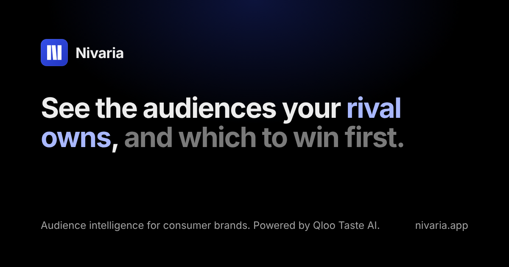
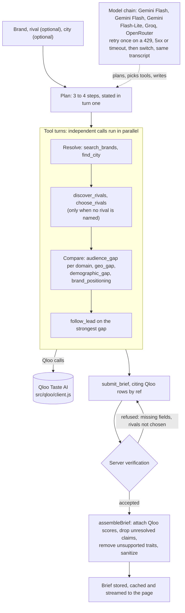

<p align="center">
  
</p>

<h1 align="center">Nivaria</h1>

<p align="center">
  <strong>Audience intelligence for consumer brands, powered by Qloo Taste AI.</strong>
</p>

Nivaria shows a consumer brand which audiences its rival owns and which to win first. Name your brand, optionally a rival and a city, or leave the rival blank and let the agent find one. An AI agent then researches both audiences with Qloo's Taste AI: the artists, films, shows, places and brands the rival's fans over-index on that yours do not, where on the city map the rival leads, and who each audience is by age and gender. It follows the strongest lead one step further, and writes a ranked plan of segments to win, each with a campaign hook built from real tastes. The model never writes a number. It cites Qloo results by reference, and the server attaches Qloo's own scores and drops any claim it cannot match to Qloo data. You watch the agent plan and work in a live trace while it runs.

**Live demo:** [nivaria.app](https://nivaria.app). Click **Try the live demo** to sign straight into a shared demo account, with no form, no signup and no email code. Ten featured briefs open instantly, and you can run your own.

**Demo video:** [youtu.be/mOfAXkR_eYE](https://youtu.be/mOfAXkR_eYE)

## How Nivaria uses Qloo

Every section of a brief comes from a Qloo call. All of them go through one client, `src/qloo/client.js`, which sends the API key, spaces requests to stay under the hackathon API's 10 per second, retries a 429 with backoff and caches identical requests in memory. The agent's tools in `src/qloo/tools.js` make the calls, and `src/taste/agent.js` decides which tools to run, runs independent ones in parallel and resolves every citation back to the Qloo row behind it.

| Qloo endpoint | What Nivaria uses it for | Where |
|---|---|---|
| `/search`, `types=urn:entity:brand` | Resolves the brand and each rival the user typed, and powers the form's autocomplete. | `searchBrands` in `src/qloo/tools.js`; `router.search` in `src/routes/taste.js` |
| `/search`, `types=urn:entity:locality` | Resolves the city. Qloo can rank a state or county above the city of the same name ("New York", "Los Angeles"), so the city is picked by place type, and its outline is kept to drop places outside it. | `findCity` in `src/qloo/tools.js` |
| `/v2/insights`, `filter.type=urn:entity:artist`, `movie`, `tv_show`, `place` or `brand` | The rival audience's top entities in one taste domain, with the rival as the signal. Places are scoped with `filter.location`. | `audienceGap` in `src/qloo/tools.js` |
| `/v2/insights` with `filter.results.entities` (cross-scoring) | Scores exactly those entities for our audience, with our brand as the signal. The difference between the two affinities is the gap. | `audienceGap` in `src/qloo/tools.js` |
| `/v2/insights`, `filter.type=urn:heatmap` | Both brands' heatmaps for the city, joined cell by cell on the same geohash grid to find where the rival leads. | `geoGap` in `src/qloo/tools.js` |
| `/v2/insights`, `filter.type=urn:entity:place` with `filter.location.geohash` | Names each hotspot cell ("Charleston, Staten Island") from the places in it. | `labelCell` in `src/qloo/tools.js` |
| `/v2/insights`, `filter.type=urn:demographics` | Age and gender affinity for both audiences. | `demographicGap` in `src/qloo/tools.js` |
| `/v2/analysis/compare` | The Qloo tags both brands share, and the ones only one side carries. | `brandPositioning` in `src/qloo/tools.js` |
| Rival discovery: `/v2/insights`, `filter.type=urn:entity:brand`, twice | With no rival named: the brands our audience over-indexes on, and the same filtered with `filter.tags` to our brand's most specific category tag (Coffee & Tea for Starbucks). Candidates are ranked by shared category tags, then affinity, and flagged when they are not competitors (same brand family, parent company, owned by our brand, a retailer). | `discoverRivals` and `chooseRivals` in `src/qloo/tools.js`; offered only when no rival is named, in `src/taste/agent.js` |
| Follow the lead: `/v2/insights` with one entity as the signal | Takes the strongest gap entity (say, an artist the rival's fans love) and asks Qloo what its fans also over-index on in music, places in the city, brands and TV. The rank 1 pick's campaign hook is built on it. | `followLead` in `src/qloo/tools.js` |

A run makes a few dozen Qloo calls. The brief shows how many of each endpoint it used.

## Technological implementation

- **A real tool-use agent.** `src/taste/agent.js` runs a loop of up to 15 model turns with a three-minute deadline. In its first turn the model states a three or four step plan (the `plan` tool) alongside its first lookups. It then calls the Qloo tools, running independent ones in parallel, and ends by calling `submit_brief` with a structured brief. A named pair typically takes four turns, and six with rival discovery. A model that skips the plan (Flash-Lite) is asked for it in a turn of its own. Near the turn or time limit, only `submit_brief` stays available.
- **Citations, not numbers.** Tool results reach the model as compact rows with short refs (`e3` for a scored entity, `c2` for a map cell, `f1` for a lead). The brief cites refs, and `assembleBrief` swaps each one for the Qloo row behind it and attaches Qloo's scores. A citation that does not resolve is dropped and counted, and the reader sees why in plain words ("1 claim in Alternative Rock and Pop Punk couldn't be matched to Qloo data and was removed.").
- **The server checks the brief.** `submit_brief` is refused, and the model asked to fix it, when a win-first pick lacks its segment, reason or hook, or when the brief arrives before the rivals are chosen. `choose_rivals` refuses a flagged candidate, or one sharing no category tag, while a better one exists.
- **Guards on the prose.** The prompt allows describing audiences only by their tastes, places, age and gender. As a backstop, a sentence that names a trait no Qloo tool returns (income, education, class, commuting, the time of day people go out) is removed. All model output passes through `src/lib/sanitizeText.js`, and names Qloo spells with "&" (R&B, H&M) are kept as Qloo writes them.
- **Never stuck on one model.** `src/taste/llm.js` keeps one provider-neutral transcript and renders it for each provider. If a model fails (a 429, a 5xx or a timeout after one retry), the run moves to the next model and keeps the whole conversation. The default chain is `gemini-3.6-flash`, `gemini-3.5-flash`, `gemini-3.5-flash-lite`, Groq (`qwen/qwen3.8-27b`) and free OpenRouter Nemotron models. Z.ai, Anthropic, Baseten, Cerebras and GitHub Models are available but off by default. A scripted stand-in (`LLM_CHAIN=scripted`) plays the model with no quota at all.
- **Live trace.** Every plan step, Qloo call, decision and model switch is streamed to the page over server-sent events, and stored with the brief.
- **Fair use of shared quota.** Good briefs are cached for 14 days. Fresh runs are limited per visitor IP (3 a day by default, one at a time), because demo visitors share one account.
- **Privacy by construction.** Prompts may go to free-tier model APIs, so only the brand, rivals and city typed for that run reach a prompt, capped in length and scrubbed of anything shaped like an email address or phone number. The modules under `src/taste` and `src/qloo` cannot import the database or session code, and `test-taste-privacy.js` checks that.
- **Tested offline.** A fake Qloo (`scripts/qloo-fake.js`) and the scripted stand-in run every test with no keys. See [Tests](#tests).

## Design

- **One click to value.** The landing page's **Try the live demo** button signs judges straight in. Ten featured briefs (Starbucks vs Dunkin' in New York, Glossier vs Fenty Beauty, Nike vs Adidas in Los Angeles and more) open instantly.
- **A brief built to act on.** Each brief reads top down: the rivals the agent chose and why, the headline, **Win these first** (a ranked plan with reasons, campaign hooks and channels, and the lead followed under the rank 1 pick), the taste segments the rival owns with both audiences' scores on every row, a city map with numbered hotspots, an age and gender chart with a table view, positioning, and how the agent built it.
- **Proof on the page.** A strip under each brief says "Every number in this brief comes from Qloo", with how many Qloo data points back it, how many claims were dropped, the endpoints called and the model that wrote it.
- **Watch it think.** The live trace pins the agent's plan at the top and ticks each step off as its Qloo calls finish. The model's narration is shown with every internal ref replaced by the name it stands for.
- **Share it.** A finished brief can be shared as a public, read-only link (`/share/<token>`: unguessable, never indexed, revocable), copied as text, or sent to Slack or Discord as a summary with the link.
- **Light and dark, desktop and phone.** One cobalt brand across the landing page, the app and the briefs, with a theme toggle that is remembered.

## Potential impact

Brand and growth teams at consumer companies already ask "who is our rival winning, and how do we reach them?" Today the answer comes from surveys, agency decks or social listening, which are slow and expensive and rarely say which segment to act on first. Nivaria answers it in about three minutes with privacy-safe taste data: which cultural segments the rival owns, which neighborhoods to put a campaign in, and a hook built from the actual artists, shows and places those fans love. Because every number is Qloo's and traceable, a marketer can take the brief into a planning meeting and defend it. The same agent works for any brand Qloo knows, in any city Qloo maps, with no setup.

## Quality of the idea

Most taste tools describe one audience. Nivaria is built on the difference between two: it takes the rival's top entities and cross-scores them for your audience, so every finding is a gap you can act on rather than a profile to read. Rival discovery lets a brand that does not know its real taste competitors find them from audience overlap and shared category, and follow the lead turns the strongest gap into a concrete campaign idea by asking Qloo what those fans love next. Underneath, the model plans and writes while the server owns the facts, which is what makes an AI-written brief trustworthy enough to use.

## Agent architecture



Every step in this diagram is also a step in the live trace.

## What changed during the hackathon

Nivaria existed before the hackathon as a B2B competitor monitoring product (see [docs/monitoring-product.md](docs/monitoring-product.md)), and its last commit before the hackathon was on 3 August 2026. Everything Qloo-powered was built during the hackathon:

- The Qloo client, the agent tools and the provider-neutral agent with its model fallback chain
- Rival discovery with category tags and competitor flags, follow the lead, and the visible plan
- Briefs with checked citations, plain-language server checks, the trait backstop, the geo-gap map and the demographics chart
- The live trace, the brief cache, the featured briefs and per-visitor limits
- Share links, Copy brief and Send to Slack or Discord
- The shared demo account and its one-click sign-in
- The new landing page, light and dark themes, and the cobalt brand and logo
- `PRODUCT_MODE=taste`, the droplet and Docker deployments, and the MIT license
- Billing was removed, so every account is on one fixed plan

## Setup

Requires Node.js 20 or later.

```bash
git clone https://github.com/UEddy/Nivaria.git
cd Nivaria
npm install
```

`npm install` skips Playwright's browser download unless `ENABLE_SCRAPER=true`. The browser is only needed by the original monitoring product.

### Offline, with no keys at all

The scripted stand-in plays the model, and a fake Qloo answers with synthetic data. Every screen works, including rival discovery, and nothing calls an outside service:

```bash
PRODUCT_MODE=taste LLM_CHAIN=scripted \
DEMO_LOGIN_EMAIL=demo@localhost.test DEMO_LOGIN_PASSWORD=local-demo-password \
node -r ./scripts/qloo-fake.js src/server.js
```

Open http://localhost:3000 and click **Try the live demo**. The featured briefs stay empty in this mode, because they are never written by the stand-in.

### With real Qloo data and models

```bash
cp .env.example .env
```

In `.env`, set at least:

```
PRODUCT_MODE=taste
QLOO_API_KEY=your_qloo_api_key
QLOO_BASE_URL=https://hackathon.api.qloo.com
GEMINI_API_KEY=your_gemini_api_key
DEMO_LOGIN_EMAIL=demo@localhost.test
DEMO_LOGIN_PASSWORD=a_password_of_at_least_12_characters
```

Then run `npm start` and open http://localhost:3000. On first boot, the first two featured briefs are written in the background. To check rival discovery against the real API without spending model quota, run `node scripts/qloo-discover.js Starbucks Glossier`.

Signing up with your own email needs `RESEND_API_KEY`, because sign-up confirms the address with a code. The demo login needs no email.

### Configuration

`.env.example` documents every variable. These are the ones that matter for Nivaria:

| Variable | Purpose |
|---|---|
| `PRODUCT_MODE` | `taste` runs Nivaria as described here. Unset runs the original monitoring product. |
| `SESSION_SECRET` | Required in production. The server refuses to start without a real one. |
| `APP_URL` | The public address. Share links and email links are built from it. |
| `QLOO_API_KEY`, `QLOO_BASE_URL` | Qloo access. The hackathon key only works on `https://hackathon.api.qloo.com`. |
| `LLM_CHAIN` | Model order, such as `gemini,groq,openrouter`. Unset uses the three Gemini models, Groq, then OpenRouter. Providers without a key are skipped. |
| `GEMINI_API_KEY`, `GROQ_API_KEY`, `OPENROUTER_API_KEY` | Keys for the default chain. |
| `GEMINI_MODEL`, `GEMINI_SECOND_MODEL`, `GEMINI_LITE_MODEL` | Override the three Gemini models. |
| `ZAI_API_KEY`, `ANTHROPIC_API_KEY`, `BASETEN_API_KEY`, `CEREBRAS_API_KEY`, `GITHUB_MODELS_TOKEN` | Optional providers, off unless named in `LLM_CHAIN` (Baseten, Cerebras and GitHub Models also need their `*_MODELS`). |
| `DEMO_LOGIN_EMAIL`, `DEMO_LOGIN_PASSWORD` | The shared demo account and the **Try the live demo** button. Unset means no demo. |
| `TASTE_FRESH_PER_DAY` | Fresh runs per visitor IP in 24 hours (default 3). |
| `TASTE_EXAMPLES` | Boot-time featured briefs: unset fills the missing ones, `refresh` rewrites the boot pairs, `off` skips them. |
| `FEATURED_CHAIN` | The models `scripts/generate-featured.js` uses (default: the model chain). |
| `ADMIN_EMAILS` | Accounts that skip the daily limit and can open `/admin`. |
| `RESEND_API_KEY`, `RESEND_FROM` | Email for sign-up and password reset codes. `RESEND_FROM` takes the form `Nivaria <noreply@your-domain>`. |
| `ENABLE_SCRAPER` | `false` turns page monitoring off (no browser, no daily checks). |
| `DATABASE_PATH` | Where the SQLite file lives (default `data/competitor-shadow.db`). |

### Stack and layout

| Layer | Stack |
|---|---|
| Server | Node.js 20+, Express 4, helmet (CSP), express-rate-limit |
| Database | SQLite through sql.js (WebAssembly, no native build), one file on disk |
| Sessions | express-session with a database-backed store, CSRF double-submit tokens |
| Taste data | Qloo Taste AI (hackathon API) |
| Models | Gemini, Groq, OpenRouter and other OpenAI-compatible APIs, and Anthropic through its SDK |
| Frontend | Vanilla JavaScript single-page app, light and dark themes, Leaflet with OpenStreetMap tiles for the map |
| Email | Resend, for sign-up and password reset codes |

| Path | What it holds |
|---|---|
| `src/qloo/client.js` | Qloo HTTP client: auth header, request spacing, 429 backoff, in-memory cache |
| `src/qloo/tools.js` | The agent's Qloo tools and their compact results |
| `src/taste/agent.js` | The agent loop, plan, system prompt, brief assembly and citation checks |
| `src/taste/llm.js` | Provider adapters and the fallback chain |
| `src/taste/display.js` | Plain-language server checks and model switches, and Qloo's "&" names kept as written |
| `src/taste/scripted.js` | The scripted model stand-in |
| `src/tasteRuns.js` | Run storage, the background runner, the live trace, the brief cache and per-visitor limits |
| `src/tasteFeatured.js` | The ten featured pairs and their boot-time generation |
| `src/tasteShares.js` | Share links and the Slack and Discord summary |
| `src/routes/taste.js` | The API under `/api/taste` |
| `src/routes/tasteShare.js` | Public shared brief pages under `/share/<token>` |
| `src/lib/demoAccount.js` | The shared demo account |
| `public/index.html` | The landing page |
| `public/js/taste.js` | The dashboard, brief, map, chart, trace and runs views |
| `deploy/` | Droplet setup and update scripts, the systemd unit, the Caddyfile and the deploy checklist |

### Deploying

**A droplet with systemd and Caddy.** `deploy/CHECKLIST.md` is a step-by-step guide to follow over SSH:

1. Point DNS for the domain at the server.
2. Run `deploy/setup.sh` once as root. It adds swap, installs Node 20 and Caddy, enables the firewall (SSH, 80 and 443 only), creates the `nivaria` user, clones the repo to `/opt/nivaria` and installs the systemd service and the Caddyfile.
3. Create `/opt/nivaria/.env` and start the service.

Caddy serves HTTPS on its own. The service runs with `PRODUCT_MODE=taste`, page monitoring off and a 350 MB memory limit. To update to the latest `main`, run `bash /opt/nivaria/deploy/update.sh`.

**Docker.**

```bash
cp .env.example .env    # set SESSION_SECRET, QLOO_API_KEY, a model key and the demo login
docker compose up -d --build
```

The image runs Nivaria in `taste` mode with page monitoring off, listens on `127.0.0.1:3000` only and keeps the database on the `nivaria-data` volume. Put a reverse proxy with HTTPS in front of it, because session cookies are Secure in production.

**Writing the featured briefs.** On a fresh database the first two featured pairs are written at boot. To write all ten, run this on the server while the service is up:

```bash
cd /opt/nivaria && sudo -u nivaria node scripts/generate-featured.js
# Docker: docker compose exec nivaria node scripts/generate-featured.js
```

It asks the running server to write each brief with the model chain, skips pairs that are already done, and stops cleanly when every model is out of quota, so it can be run again to resume. `--provider gemini` limits it to one provider.

### Tests

Each test is a plain Node script that runs offline, on a throwaway database, with the fake Qloo and the scripted stand-in:

```bash
for t in test-taste-*.js test-qloo-rate.js test-demo-login.js test-sanitize-text.js; do node "$t"; done
```

| Suite | Covers |
|---|---|
| `test-taste-routes.js` | Starting, streaming, reading and rerunning runs; ownership; the plan; rival discovery; follow the lead; the cache; featured briefs |
| `test-taste-brief.js` | Brief assembly: citation resolution, hotspots, lead citations, the trait backstop and refs in the narration |
| `test-taste-cache.js` | The brief cache, per-visitor limits, the model chain order, friendly failure messages and the featured-brief script |
| `test-taste-share.js` | Share links, the public page and Send to Slack or Discord |
| `test-taste-privacy.js` | What can reach a model prompt |
| `test-qloo-rate.js` | Staying under Qloo's rate limit with several runs at once |
| `test-demo-login.js` | The demo account, the one-click sign-in and its limits (boots the real server) |
| `test-sanitize-text.js` | The dash and connector-plus post-processor |

### Scripts

| Script | Purpose |
|---|---|
| `scripts/taste-cli.js` | Run one brief from the command line: `--brand`, `--rival` (repeatable), `--city`. |
| `scripts/generate-featured.js` | Write the featured briefs through the running server. |
| `scripts/qloo-discover.js` | Check rival discovery on the real Qloo API, with no model calls. |
| `scripts/qloo-smoke.js` | One call per Qloo endpoint, saving sample responses under the git-ignored `data/`. |
| `scripts/qloo-fake.js` | Synthetic Qloo answers, preloaded with `node -r` for offline work and tests. |
| `scripts/verify-workspace-integrity.js` | Database integrity check to run before a deploy. |

## The original monitoring product

The B2B competitor monitoring product that Nivaria started as still ships in this codebase and runs when `PRODUCT_MODE` is unset. It is documented in [docs/monitoring-product.md](docs/monitoring-product.md), with its roadmap and backlog alongside.

## Security and data rights

See [SECURITY.md](SECURITY.md). Account data, briefs and share links included, can be exported (`GET /api/account/export`) and deleted (`POST /api/account/delete`, immediately, after the password and the typed account email are checked). The [Terms of Service](https://nivaria.app/terms), [Privacy Policy](https://nivaria.app/privacy) and [Cookie Policy](https://nivaria.app/cookies) describe the app as it runs today (sources in `docs/legal/`).

## License

[MIT](LICENSE). Built by Ediong Udotong.
