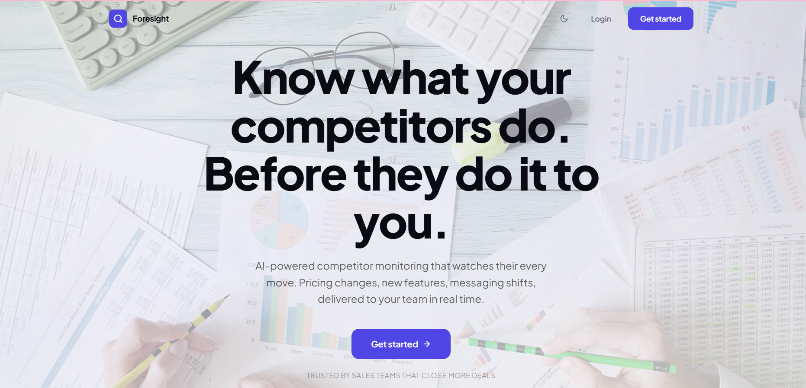
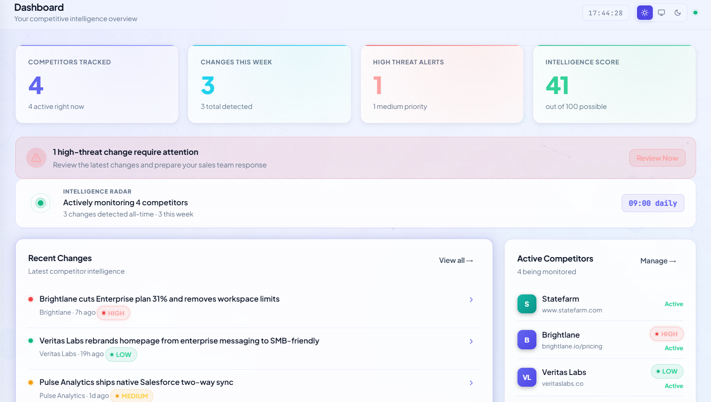
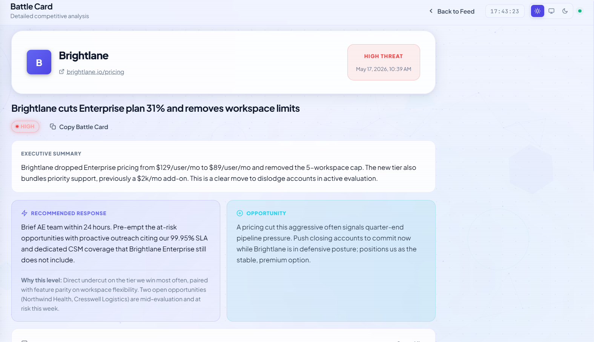

# 🔍 Nivaria

*AI-powered competitor intelligence for B2B sales teams.*

## Overview

Nivaria watches competitor websites on a schedule, detects meaningful changes, and uses Claude to turn each difference into a structured brief with threat scoring and a recommended response. Sales teams learn about a competitor's new pricing, feature launch, or messaging shift the day it ships, not weeks later from a deal they lost. The product replaces a manual research process that most B2B teams either skip entirely or assign to whoever has the least to do.

## Why I built this

I built Nivaria from the ground up as a full-stack solution to help B2B businesses turn competitor activity into closed deals. I personally drove the architectural decisions: selecting WASM SQLite over a native driver, building the synchronous database adapter, designing database-backed session storage, implementing the tier-enforcement layer, creating the multi-step OTP authentication flow, and engineering the AI prompts that generate competitor briefs. The aim was to deliver a product that combines technical depth with real commercial judgment, built for the way B2B sales and marketing teams actually work.

## Features

- Email and OTP-based authentication with verification on registration
- Password reset flow with rate-limited OTP delivery
- One fixed plan for every account (5 monitored pages, every feature on), enforced server-side on every protected route
- Competitor monitoring dashboard with paused or active state and per-source change history
- AI-generated briefs: headline, summary, threat score (low, medium, high), recommended response, and sales talking points
- Slack and Discord webhook alerts when changes are detected
- Daily scheduled checks via cron, with per-competitor manual re-check
- Pre-meeting briefings: connect Google Calendar and get a brief pushed to your webhook 30 min before any meeting that mentions a tracked competitor (by title or attendee domain)
- Win/loss logging and a Revenue Impact Dashboard: tag deal outcomes to competitors (in-app or via a Slack slash command) and Nivaria correlates losses with competitor activity to estimate revenue at risk
- Slack deal logging: `/foresight lost-deal Acme $40K vs BambooHR` logs a deal in one line, with request-signature verification and replay protection
- Three-mode theme system (system, light, dark) with anti-flash inline detection

## Tech stack

- **Backend**: Node.js, Express
- **Database**: SQLite via sql.js (pure WASM, no native compilation step)
- **AI**: Anthropic API (Claude Sonnet 4.6)
- **Email**: Resend for OTP delivery
- **Sessions**: express-session with a DB-backed store
- **Auth**: bcrypt password hashing with server-side session invalidation
- **Frontend**: Vanilla JS SPA, no framework runtime, dark-first design

## Screenshots







## Running locally

1. Clone the repository:
   ```bash
   git clone https://github.com/UEddy/Nivaria.git
   cd Nivaria
   ```
2. Install dependencies:
   ```bash
   npm install
   ```
3. Create a local environment file from the template:
   ```bash
   cp .env.example .env
   ```
   At minimum, set `ANTHROPIC_API_KEY` and `RESEND_API_KEY` in the new `.env`.
4. Start the server:
   ```bash
   npm start
   ```
5. Open http://localhost:3000. Demo data is seeded on first run, and demo credentials are printed to the console.

## Run with Docker

The image runs only Nivaria's audience briefs (`PRODUCT_MODE=taste`), with page monitoring off (`ENABLE_SCRAPER=false`, so no browser is installed) and `NODE_ENV=production`.

1. Create `.env` from `.env.example` and set at least `SESSION_SECRET`, `QLOO_API_KEY` and one model key (for example `GEMINI_API_KEY`). Set `DEMO_LOGIN_EMAIL` and `DEMO_LOGIN_PASSWORD` for a shared judge login.
2. Build and start it:
   ```bash
   docker compose up -d --build
   ```
3. The app listens on `127.0.0.1:3000` only. Put a reverse proxy with HTTPS in front of it, because session cookies are Secure in production.

The database lives on the `nivaria-data` volume. On first boot with an empty volume, the first two featured briefs are generated in the background, which takes a few minutes. To write all ten with Gemini, run `docker compose exec nivaria node scripts/generate-featured.js` once the container is up. It skips briefs that are already written, stops cleanly if Gemini runs out of quota, and can be run again to resume.

## Calendar setup (pre-meeting briefings)

Phase 7 connects Google Calendar so Nivaria can push a briefing to your Slack/Discord webhook 30 minutes before any meeting that mentions a tracked competitor.

1. **Generate the token-encryption key** and paste it into `.env` as `CALENDAR_TOKEN_ENCRYPTION_KEY`:
   ```bash
   node -e "console.log(require('crypto').randomBytes(32).toString('hex'))"
   ```
2. **Create Google OAuth credentials**:
   - Visit [Google Cloud Console → Credentials](https://console.cloud.google.com/apis/credentials).
   - "Create Credentials" → "OAuth client ID" → application type "Web application".
   - Under "Authorized redirect URIs" add exactly: `http://localhost:3000/api/calendar/google/callback` (replace host for production).
   - Under "APIs & Services → Library", enable the **Google Calendar API**.
   - Paste the client ID and secret into `.env` as `GOOGLE_OAUTH_CLIENT_ID` and `GOOGLE_OAUTH_CLIENT_SECRET`.
3. **Restart the server**, open `/app#/settings`, and click "Connect Google Calendar".
4. While the OAuth app is in "Testing" status, only emails listed under "OAuth consent screen → Test users" can complete the flow. For production, follow Google's app verification process. See "Production OAuth verification" below.

### Production OAuth verification

Before launching publicly, the Google OAuth app must move from "Testing" → "In production" via Google's verification process. While unverified:
- Users hit a "Google hasn't verified this app" warning screen at consent time
- "Continue" requires clicking "Advanced" → "Go to Nivaria (unsafe)"
- The 100-user test cap applies

Verification is a separate launch task. Submit at OAuth consent screen → "Publish app" with a privacy policy URL, app domain, and brand verification artifacts. Sensitive scopes (Calendar API counts as sensitive) require a 4 to 8 week review.

## Win/loss & ROI

Sales representatives log deal outcomes and Nivaria quantifies what competitors cost the business. For every lost or stalled deal tagged to a competitor, the engine looks at that competitor's meaningful changes in the 30 days before the deal closed, classifies them (pricing / messaging / feature), and surfaces patterns like "8 of your 12 tracked deals against Acme closed within 30 days of a pricing change."

- The math is pure data analysis, no AI: simple correlation and counting, which is the honest ceiling for the sample sizes these teams have. Confidence is a function of supporting-deal count (low 3 to 5, medium 6 to 14, high 15+), every finding says "correlates with" rather than "caused", and small samples are flagged.
- Two logging paths, both optimized for speed: an inline form on the Deals page (no modal), and the Slack slash command below.
- Correlations recompute nightly per user (2:30 AM) and on demand when the Revenue Impact Dashboard is opened.

## Plan

There is no billing. Every account is on one fixed plan: up to 5 monitored pages (and up to 5 per competitor), daily checks, Slack and Discord alerts, calendar briefings, outreach playbooks, win/loss correlation and historical context. There is no trial, checkout or subscription. The limits live in `src/lib/tierLimits.js`; accounts in `ADMIN_EMAILS` and accounts with the developer flag have no page cap.

### Legacy billing tables

Lemon Squeezy billing was removed on 2026-10-29. Its tables and columns were left in place, unused, so no destructive migration was needed:

- `payment_events`: the Lemon Squeezy webhook log. Existing rows are kept for accounting records and anonymized (`workspace_id` set to NULL) when an account is deleted.
- `waitlist_signups`: Team and Business waitlist signups and 14-day trial requests.
- `workspaces` columns `subscription_id`, `subscription_status`, `subscription_tier`, `subscription_current_period_end`, `subscription_cancel_at_period_end`, `tier_granted_at`, `lemon_squeezy_customer_id`, `lemon_squeezy_subscription_variant_id`, `trial_ends_at` and `trial_notices`.
- `users.tier`.

Nothing reads or writes them. Drop them in a later migration if you want the schema tidy.

### GDPR data rights

`GET /api/account/export` (full JSON export, OAuth tokens masked) and `POST /api/account/delete` (30-day grace period, email cancellation link, legacy payment records retained but anonymized) are built in. Both deletion endpoints require re-entering the password (fresh auth). Run `node scripts/verify-workspace-integrity.js` before any deploy (see [SECURITY.md](SECURITY.md)).

### Slack deal logging setup

Connect a Slack workspace so sales representatives can log deals without leaving Slack.

1. **Create a Slack app** at [api.slack.com/apps](https://api.slack.com/apps) ("From scratch").
2. **Signing secret** (required): Basic Information -> App Credentials -> Signing Secret. Put it in `.env` as `SLACK_SIGNING_SECRET`. The slash command endpoint verifies every request's signature and rejects anything older than 5 minutes (replay protection).
3. **Bot scope and OAuth**: OAuth & Permissions -> Bot Token Scopes -> add `commands`. Add `http://localhost:3000/api/slack/oauth/callback` (adjust host for production) under Redirect URLs. Copy the Client ID and Client Secret into `.env` as `SLACK_CLIENT_ID` / `SLACK_CLIENT_SECRET` / `SLACK_REDIRECT_URI`. This powers the "Add to Slack" button in Settings, which links the installing Slack user to their Nivaria account.
4. **Slash command**: Slash Commands -> Create New Command:
   - Command: `/foresight`
   - Request URL: `https://YOUR_HOST/api/slack/commands`
   - Usage hint: `lost-deal Acme $40K vs BambooHR`
5. **Interactivity** (for the competitor-picker buttons when a name doesn't match): Interactivity & Shortcuts -> on -> Request URL `https://YOUR_HOST/api/slack/interactions`.
6. In Nivaria, open Settings and click **Add to Slack**, then try `/foresight lost-deal Acme $40K vs BambooHR` in any channel.

Command syntax: `/foresight <outcome> <deal name> [$value] [vs competitor]`, where outcome is `lost-deal`, `won-deal`, or `stalled`. The value parser accepts `$40K`, `40000`, `$40,000`, and `1.5M`. Responses are ephemeral, so a deal's value is only ever shown to the person who logged it.

## Roadmap

### Next 7 days

- Production security hardening: nonce-based CSP, Redis-backed rate limiter, shared session store
- Deploy to a production environment behind HTTPS

### Next 30 days

- CRM integration (HubSpot, Salesforce) to auto-import deal outcomes instead of manual and Slack logging
- Vertical-specific brief templates (fintech, devtools, healthcare)
- Microsoft 365 Calendar provider (Phase 7 has a Google-only implementation; the abstraction is provider-agnostic)

---

Built by Ediong Udotong.
